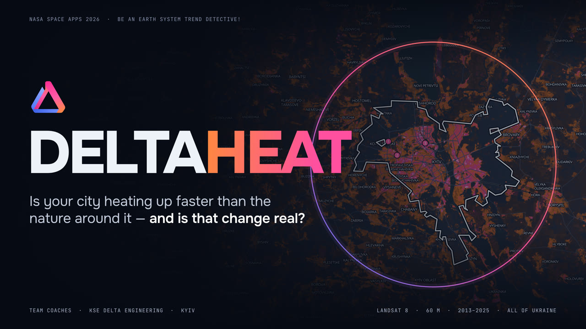

# DELTAHEAT

**Is my city heating up faster than the nature around it — and is that change real?**

NASA Space Apps Challenge 2026 · Kyiv · Team **Coaches** (KSE Delta Engineering)
Challenge: [Be An Earth System Trend Detective!](https://www.spaceappschallenge.org/2026/challenges/earth-system-trend-detective/)

- **Live app:** https://nasa-hackathon.hlushchenko.dev/
- **Slides (PPTX):** [`docs/pitch/DELTAHEAT_slides.pptx`](docs/pitch/DELTAHEAT_slides.pptx)
- **Slides video:** [`docs/pitch/DELTAHEAT_slides.mp4`](docs/pitch/DELTAHEAT_slides.mp4)

[](docs/pitch/DELTAHEAT_slides.mp4)

## The problem

Every summer the city feels hotter. But a feeling is not evidence: was it just a hot summer? Is it the climate, or my neighbourhood? Is it getting worse, or was it always like this?

## Our idea: subtract the forest

The forest around a city lives under the same sky: the same heat waves, the same regional climate. So we compare

**gap = surface temperature of the built-up area − surface temperature of the nearby forest**

for every summer 2013–2025 and test whether the gap changes. A hot or a cool summer moves both numbers; the gap stays comparable from year to year.

| Challenge question | DELTAHEAT |
|---|---|
| **What** is changing? | Summer daytime land surface temperature, NASA/USGS Landsat 8 |
| **Where?** | Any city, district, address or hand-drawn area in Ukraine, on a 60 m analysis grid |
| **How much?** | °C per 10 years (Theil–Sen slope with 95% CI) |
| **Is it significant?** | Mann–Kendall test, p < 0.05 — if not, the app says so plainly |

The answer is one sentence, one number and one chart. Behind it: map layers (gap, temperature, greenness, greenness change), the hottest spots, land cover of the area, export, and a built-in AI chat.

## Try it in 1 minute

| | |
|---|---|
| [All of Kyiv](https://nasa-hackathon.hlushchenko.dev/?zone=kyiv&lang=en) | +8.0 °C hotter than the forest — but no significant trend (p = 0.76) |
| [Nyzhni Sady, Osokorky](https://nasa-hackathon.hlushchenko.dev/?zone=demo-nyzhni-sady&lang=en) | The gap grows **+1.9 °C / 10 yr** (p = 0.002) |
| [Desnianske, Troieshchyna](https://nasa-hackathon.hlushchenko.dev/?zone=demo-desnianske&lang=en) | The gap shrinks **−2.5 °C / 10 yr** (p = 0.03) while greenness rose — open *Greenness change* |

One city, one climate — opposite trends.

## Why you can trust it

- **Fair reference:** only stable forest, within ±100 m of the area's elevation, clipped at the state border.
- **Honest verdicts:** "significant" only when the test says so; most places honestly get "not yet significant".
- **Caveats in the UI:** few summers, cloud gaps, the 60 m grid (the Landsat thermal band is 100 m), occupied territories.
- **A trend, not a cause:** the app shows where and how much the gap changes; greenness and land cover are shown next to it as context, not as proof of why.

Full method: [`docs/METHOD.md`](docs/METHOD.md) (version `sci-v3.6`).

## Who it is for

- **Residents** — evidence about their own street, not a feeling.
- **Students** — real NASA data and statistics they can explore.
- **Cities** — where to plant trees and how to rebuild cooler.
- **Scientists** — open method and exportable per-summer data.

## Data and resources

| Data | Agency / author | Where we get it | How we use it |
|---|---|---|---|
| Landsat 8 Collection 2 Level-2 | NASA / USGS | Microsoft Planetary Computer (`landsat-c2-l2`) | Summer land surface temperature and NDVI, 2013–2025 — the core of every number |
| NEX-GDDP-CMIP6 | NASA | Microsoft Planetary Computer (`nasa-nex-gddp-cmip6`) | Climate outlook: summer air temperature to 2100 |
| WorldCover 2021 | ESA | Microsoft Planetary Computer (`esa-worldcover`) | Stable forest mask for the reference |
| Land Cover 10 m, yearly | Esri / Impact Observatory | Microsoft Planetary Computer (`io-lulc-annual-v02`) | Built-up and nature classes per year |
| GHSL built-up surface | European Commission JRC | JRC open data FTP | Built-up share and its change |
| Copernicus DEM GLO-90 | ESA / Copernicus | Public AWS bucket | Elevation match of the reference forest (±100 m) |
| ERA5 weather archive | ECMWF / Copernicus | Open-Meteo API | Air temperature and weather on the days of satellite passes |
| OpenStreetMap | OSM contributors | Nominatim, Overpass, OpenFreeMap tiles | Address search, district borders, water, base map |
| World Imagery Wayback | Esri, Maxar | Esri tile service | Satellite basemap by year |
| Sentinel-2 cloudless | EOX (Copernicus Sentinel data) | EOX tile service | Fallback satellite basemap |
| Occupied territories list | Ministry of Development of Ukraine, order No. 376 | zakon.rada.gov.ua | Caveat and overlay for occupied areas |

## AI use

- **Ask the analyst** — a built-in chat (Anthropic Claude): ask about any place in plain language; it answers from the report, and the numbers in its answer are checked against it.
- **In development:** Anthropic Claude, Google Gemini and OpenAI ChatGPT for code, review, auto-tests and documentation.

## Team Coaches

- Volodymyr Baran
- Oleksandr Hlushchenko
- Yaroslav Panchenko
- Roman Yarosh
- Ivan Oliynyk

## For developers

> [!WARNING]
> The satellite data (the Landsat archive and the rasters computed from it) is stored only on our server that runs the demo — it is not in this repository. To see real results, use the [live app](https://nasa-hackathon.hlushchenko.dev/). A local frontend runs on built-in sample data only.

| Path | |
|---|---|
| [`backend/`](backend/) | FastAPI: analysis, map tiles, AI analyst |
| [`frontend/`](frontend/) | React + TypeScript + MapLibre web app |
| [`docs/`](docs/) | Method, API, slides and video |
| [`pipeline/`](pipeline/) | Landsat ingestion and processing |

```bash
# frontend with built-in sample data, no backend needed
cd frontend && npm install && npm run dev:fixtures

# backend (needs the prepared rasters on disk)
cd backend && uv sync && uv run uvicorn uhd.api:app --port 8100
```

Settings: environment variables with the `UHD_` prefix; the AI analyst needs `ANTHROPIC_API_KEY`.
